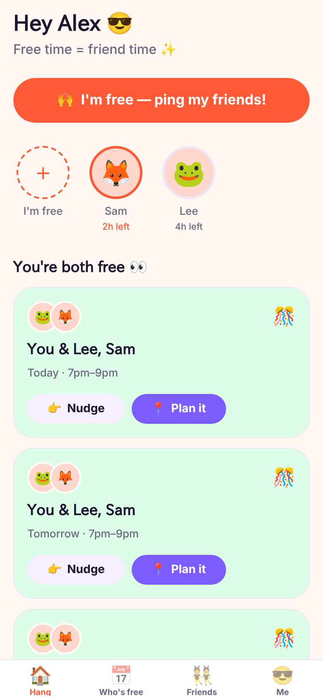
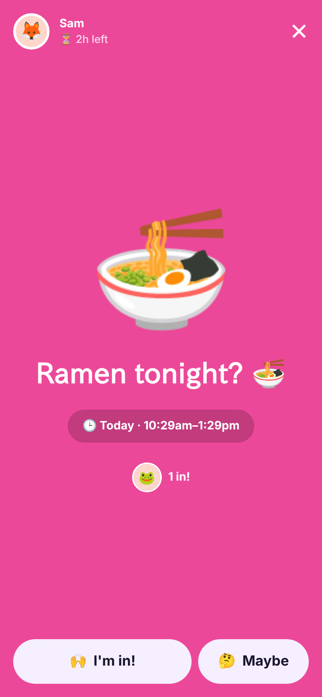
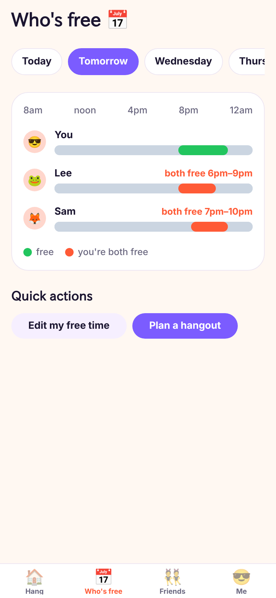
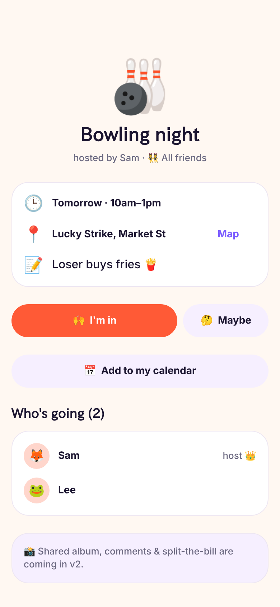

# 👋 Pingle

**See when your friends are free. Ping them. Go hang out.**

One codebase for iOS, Android and web: Expo (React Native) + Expo Router + Supabase.

| Home | Ping | Who's free | Hangout |
|---|---|---|---|
|  |  |  |  |

## What's in v1

| Feature | Where |
|---|---|
| Sign up / sign in (email + password), profile with emoji avatar, bio, username | `src/app/sign-in.tsx`, `src/app/edit-profile.tsx` |
| Weekly free-time routine (presets + custom) and one-off free slots | `src/app/availability.tsx` |
| **Calendar sync** (reads busy *times* only from every calendar on the phone: Apple, Google, Outlook…) | `src/lib/calendar.ts` |
| **Suggestions**: open calendar gaps at social hours ("Looks like you're free") + recurring routines learned from your calendar | `src/lib/availability.ts` |
| **"You're both free 👀"**: overlap matching across friends (time-zone aware), with **Nudge** (push) and **Plan it** | `src/app/(tabs)/index.tsx` |
| **Pings**: "I'm free!" posts with a GIF or sticker, push-notify friends, disappear like stories, "I'm in / Maybe" | `src/app/ping/*` |
| Hangouts: time, location (+ map link), details, who's going, RSVP | `src/app/activity/*` |
| Visibility: all friends, a circle, or invite-only | `supabase/migrations/…_init.sql` (enforced in the database by RLS) |
| Add to calendar (native calendar on phones, `.ics` download on web) | `src/lib/calendar.ts` |
| Friends (search, requests, invite share) and circles | `src/app/(tabs)/friends.tsx`, `src/app/circles.tsx` |

## Setup

### 1. Install

```bash
npm install
```

### 2. Create a Supabase project (free tier)

1. Create a project at [supabase.com](https://supabase.com).
2. Apply the schema: either paste `supabase/migrations/20261109000000_init.sql` into **SQL Editor → Run**, or with the CLI:
   ```bash
   npx supabase link --project-ref YOUR-REF
   npx supabase db push
   ```
3. Deploy the push-notification functions:
   ```bash
   npx supabase functions deploy send-ping
   npx supabase functions deploy nudge
   ```
4. For quick testing, you can turn off "Confirm email" under **Authentication → Providers → Email**.

### 3. Environment

```bash
cp .env.example .env
```

Fill in `EXPO_PUBLIC_SUPABASE_URL` and `EXPO_PUBLIC_SUPABASE_ANON_KEY` (Supabase → Project Settings → API).
Optional: `EXPO_PUBLIC_GIPHY_API_KEY` for GIF search ([developers.giphy.com](https://developers.giphy.com)); without it, the app uses emoji stickers.

### 4. Run

```bash
npm run web        # browser
npx expo start     # scan the QR code with Expo Go for a quick look
```

Calendar sync and push notifications need a **development build**, not Expo Go:

```bash
npx eas-cli@latest init                       # links an EAS project (enables push tokens)
npx eas-cli@latest build --profile development --platform ios     # or android
```

## Tests

```bash
npm test          # availability engine: free time, overlaps, time zones/DST, suggestions, .ics
npm run test:db   # database schema + row-level security, on in-process Postgres (PGlite)
npm run typecheck
npm run lint
```

## How it works

- **Free time** = (weekly routine ∪ one-off free slots) − busy calendar blocks. Routines are stored in the owner's time zone, so overlaps are correct across zones and daylight saving.
- **Privacy:** calendar sync uploads only start/end times, never titles. Friends can read your availability; strangers can't. Push tokens are private. All of this is enforced by Postgres row-level security, not just the UI.
- **Pings** expire (1h–24h, or when the free window ends) and vanish for friends at the database level. The `send-ping` edge function pushes to every friend who can see it, via Expo's push service (APNs + FCM).

## Next up

- Google Calendar sync on web (OAuth free/busy)
- Scheduled server-side "you're both free" nudges (cron edge function)
- Sign in with Apple / Google
- Rich GIF previews inside iOS notifications (notification service extension)
- v2: nearby activity ideas, interests in profile, shared photo albums, comments, SMS invites, split-the-bill
